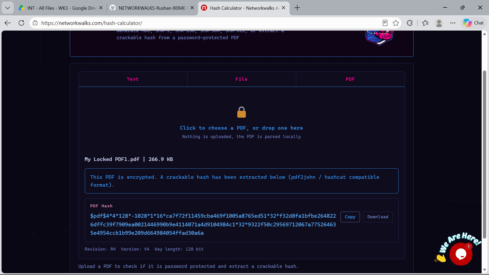
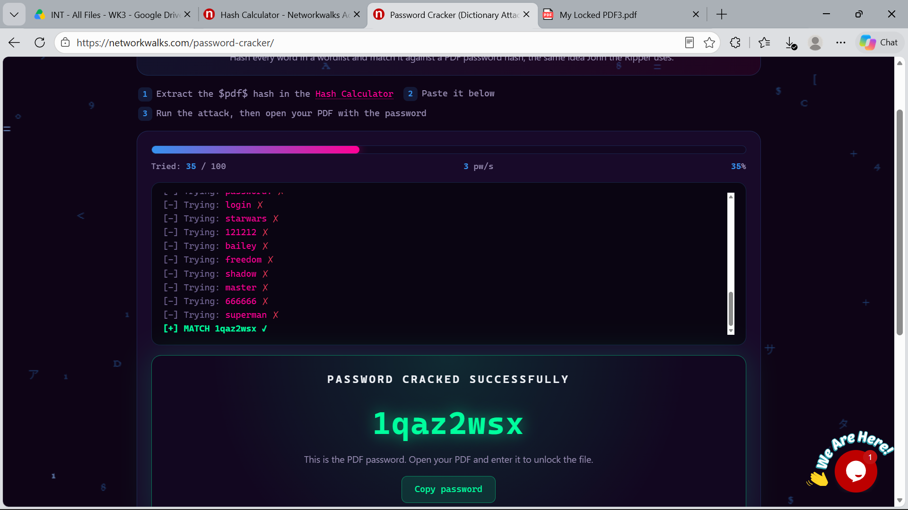
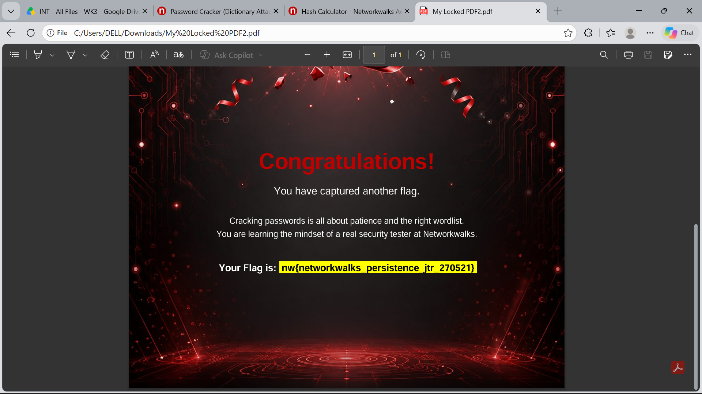
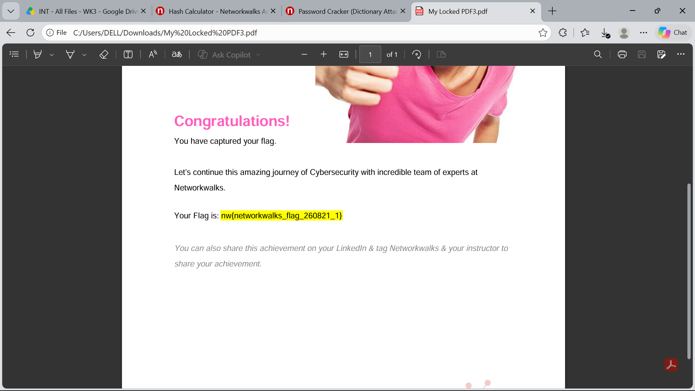
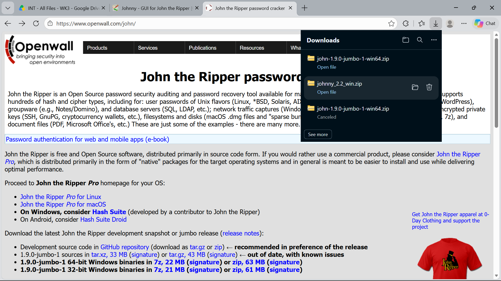
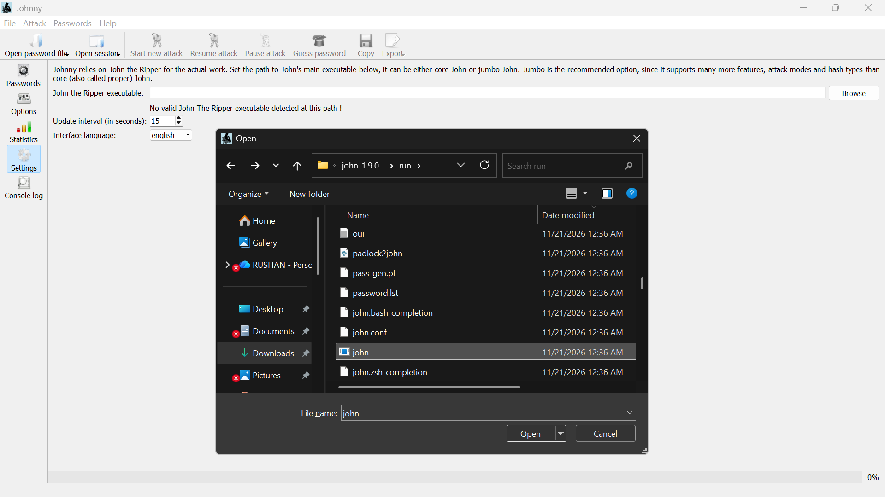
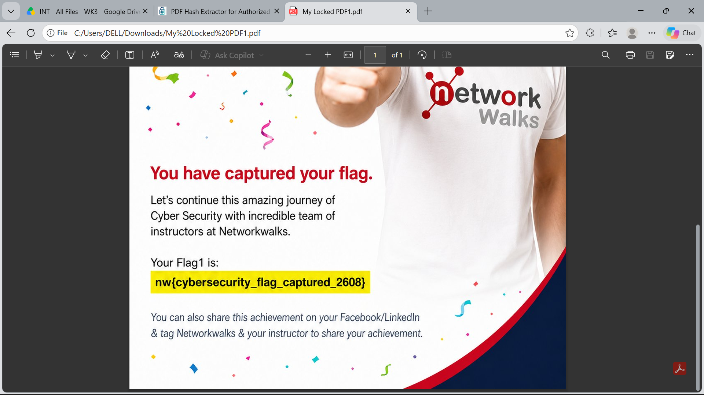

# 🔐 PASSWORD CRACKING & FLAG HUNTING

### Networkwalks | Week 03 | Batch B084

**Prepared By: Ansari Rushan Aslam**

## 1. Introduction

This project focuses on PDF hash extraction, password cracking, and flag hunting. During Week 3, I explored dictionary attacks using Networkwalks online tools and Johnny (John the Ripper).

## 2. Objectives

- Extract password hashes from PDF files.
- Understand dictionary attacks.
- Explore Networkwalks Password Cracker.
- Use Johnny and John the Ripper.
- Recover PDF passwords and capture flags.

## 3. Tools Used

- PDF Hash Extractor
- Networkwalks Hash Calculator
- Networkwalks Password Cracker
- Johnny
- John the Ripper Jumbo
- Wordlists

---

## 4. Networkwalks Flag Hunting

### 4.1 PDF Hash Extraction

Extracted password hashes from the assigned PDF files using the PDF Hash Extractor.

### 4.2 Dictionary Attack

Used the Networkwalks Password Cracker to perform dictionary attacks against the extracted PDF hashes.

### 4.3 Password Recovery

Successfully recovered passwords from two assigned PDF files.

| PDF | Recovered Password |
|---|---|
| PDF 2 | `password1` |
| PDF 3 | `1qaz2wsx` |

### 4.4 Captured Flags

**PDF 2:**

`nw{networkwalks_persistence_jtr_270521}`

**PDF 3:**

`nw{networkwalks_flag_260821_1}`

---

## 5. Johnny – John the Ripper Flag Hunting

### 5.1 Tool Setup

Downloaded and configured John the Ripper Jumbo with Johnny, its graphical user interface.

### 5.2 Password Cracking

Loaded the extracted PDF hash into Johnny and performed password recovery using the available wordlist.

**Recovered Password:** `good-luck`

### 5.3 Captured Flag

Successfully recovered the password and unlocked PDF 1 to capture the flag.

`nw{cybersecurity_flag_captured_2608}`

---

## 6. Key Learnings

- PDF hash extraction.
- Dictionary-based password attacks.
- Wordlist-based password recovery.
- Using Networkwalks Password Cracker.
- Working with Johnny and John the Ripper.
- Understanding password security.

## 7. Conclusion

Successfully completed Week 3 password-cracking exercises using Networkwalks tools and Johnny (John the Ripper). Recovered all three PDF passwords and captured all assigned flags.

## 8. Author

**Ansari Rushan Aslam**

Cybersecurity Trainee | Networkwalks | Batch B084

[GitHub](https://github.com/rushan-2024) | [LinkedIn](https://www.linkedin.com/in/rushan-ansari-19a5aa372/)

---

**LEARN • PRACTICE • SECURE**

