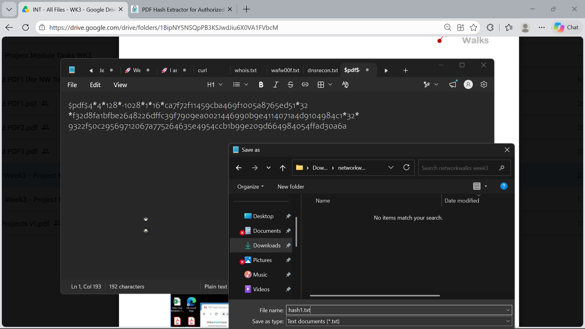
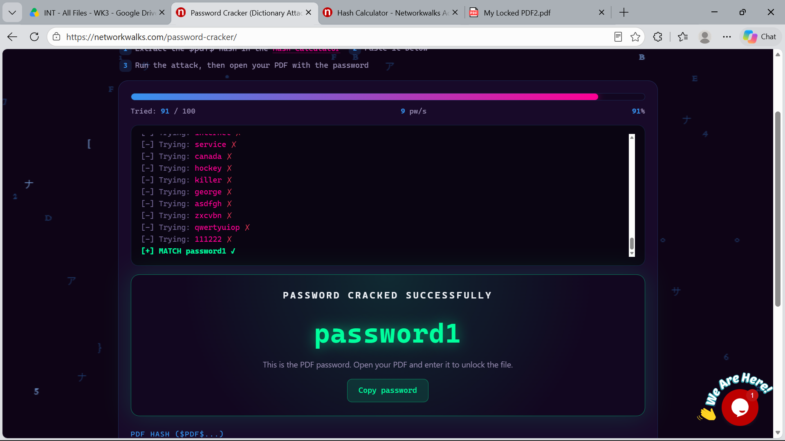
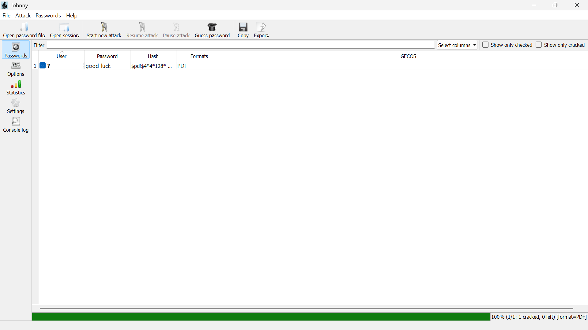

# 🔐 PASSWORD CRACKING & PDF PASSWORD RECOVERY

### Networkwalks | Week 03 | Batch B084

**Prepared By: Ansari Rushan Aslam**

## 1. Introduction

This project focuses on PDF hash extraction, password security, and dictionary attacks. I practiced recovering passwords from protected PDF files using Networkwalks tools and John the Ripper.

## 2. Objectives

- Extract password hashes from PDF files.
- Understand dictionary attacks.
- Use password-cracking tools.
- Explore Johnny and John the Ripper.
- Recover PDF passwords and capture CTF flags.

## 3. Tools Used

- PDF Hash Extractor
- Networkwalks Hash Calculator
- Networkwalks Password Cracker
- Johnny
- John the Ripper Jumbo
- Wordlists

## 4. Practical Activities

### 4.1 PDF Hash Extraction

Extracted password hashes from the assigned PDF files and saved them in text format.

### 4.2 Dictionary Attack

Used the Networkwalks Password Cracker to perform dictionary attacks against the extracted hashes.

### 4.3 PDF Password Recovery

Successfully recovered passwords from all three PDF files.

| PDF | Recovered Password |
|---|---|
| PDF 1 | `good-luck` |
| PDF 2 | `password1` |
| PDF 3 | `1qaz2wsx` |

### 4.4 John the Ripper & Johnny

Installed John the Ripper Jumbo and explored its configuration and password recovery functionality through Johnny.

## 5. Captured Flags

**PDF 1**
`nw{cybersecurity_flag_captured_2608}`

**PDF 2**
`nw{networkwalks_persistence_jtr_270521}`

**PDF 3**
`nw{networkwalks_flag_260821_1}`

## 6. Key Learnings

- PDF hash extraction.
- Dictionary-based password attacks.
- Wordlist usage.
- John the Ripper and Johnny.
- Password security and recovery.

## 7. Conclusion

Successfully completed Week 3 practical exercises, recovered all three PDF passwords, and captured all assigned flags. This practical improved my understanding of password hashing and dictionary-based attacks.

## 8. Author

**Ansari Rushan Aslam**

Cybersecurity Trainee | Networkwalks | Batch B084

[GitHub](https://github.com/rushan-2024) | [LinkedIn](https://www.linkedin.com/in/rushan-ansari-19a5aa372/)

---

**LEARN • PRACTICE • SECURE**

